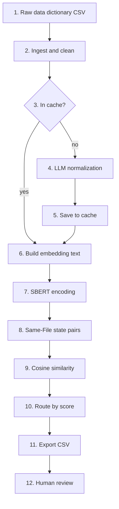

# HSIS Metadata Matcher

Matches equivalent variables across state DOT data dictionaries. For each pair of states, it compares every variable in one state's file against every variable in the other state's file of the same type, scores the similarity, and sorts each pair into **accepted**, **human review**, or **rejected**.

This is a from-scratch rebuild of the earlier master-schema version: [hsis-metadata-nlp (archived)](https://github.com/tasnimhossenctr/hsis-metadata-nlp). That version matched each state to a fixed master schema. This version compares states directly.

## How it works

1. **Input.** Read the raw data dictionary CSV.
2. **Ingest and clean.** Validate columns, trim whitespace, drop blank and duplicate rows, and apply `--exclude_states`.
3. **Check the cache.** If a variable was already normalized, reuse the saved result.
4. **LLM normalization.** For uncached variables, an LLM (Gemini or OpenAI) returns a standard name, domain, description, and unit. `offline` mode skips the LLM.
5. **Save to cache.** Each result is written to disk as it finishes, so interrupted runs resume where they stopped.
6. **Build embedding text.** Each variable becomes `"<standard name>: <description>"`.
7. **SBERT encoding.** `all-MiniLM-L6-v2` turns each text into a 384-dimensional vector.
8. **Generate pairs.** Pairs form only within the same `File`, across every pair of different states.
9. **Cosine similarity.** Score every pair.
10. **Route by score.** Apply the thresholds below.
11. **Export.** Write one CSV with a `decision` column.
12. **Human review.** Reviewers check the `hitl_review` rows and fill in `reviewer_status` and `reviewer_notes`.



## Design rules

- **Pairs stay within the same `File`.** Roadway variables are only compared with Roadway variables, and Crash with Crash. A state is never compared with itself.
- **`Field_Type` is not a filter.** A Numeric field can still pair with a Coded one. It is also left out of the embedding text, because including it (along with the file name) made unrelated variables score too similarly.
- **Routing thresholds:**

  | Cosine similarity | Decision |
  |---|---|
  | >= 0.82 | `accepted` |
  | 0.70 to < 0.82 | `hitl_review` |
  | < 0.70 | `rejected` |

- **One entry point.** `src/hsis_crosswalk_engine.py` runs the whole pipeline.
- **One results file.** A single CSV with a `decision` column replaces the old tiered crosswalk files.

## Input format

The input CSV must have these columns:

```
State,File,Variable_Name,Description,Field_Type
```

Example:

```
WA,Roadway,SPEED_LIMIT,Posted Speed Limit,Numeric
OH,Roadway,POSTED_SPEED_NBR,Speed Limit of Road,Numeric
```

Save the file as UTF-8. A file saved from Excel may use a different encoding and fail with a `UnicodeDecodeError`. In Excel, choose "CSV UTF-8" when saving.

## Project layout

```
.
├── README.md
├── requirements.txt
├── .env.example
├── data/
│   ├── raw_states/hsis_raw_schema.csv    # input
│   └── cache/llm_normalizations.json     # LLM cache (gitignored)
├── src/
│   ├── hsis_crosswalk_engine.py          # entry point
│   ├── llm_normalizer.py                 # normalization, cache, Gemini/OpenAI
│   └── pair_scorer.py                    # embedding, pairing, scoring, routing
├── outputs/                              # results (gitignored)
└── tests/
```

## Setup

```bash
python -m venv .venv
source .venv/bin/activate        # Windows: .venv\Scripts\Activate.ps1
pip install -r requirements.txt
```

Set credentials as environment variables (Codespaces secrets or a local `.env`). Never commit real keys. See `.env.example`.

| Variable | Needed for | Notes |
|---|---|---|
| `GEMINI_API_KEY` | `--llm_provider gemini` | Required for Gemini |
| `GEMINI_MODEL` | optional | Pins one model and disables the fallback chain |
| `OPENAI_API_KEY` | `--llm_provider openai` | Required for OpenAI |
| `OPENAI_MODEL` | optional | Defaults to `gpt-4o-mini` |
| `OPENAI_BASE_URL` | optional | Only if your organization uses a gateway |

## Usage

```bash
# Gemini (default)
python src/hsis_crosswalk_engine.py --llm_provider gemini --exclude_states USAH USAN

# OpenAI
python src/hsis_crosswalk_engine.py --llm_provider openai

# Offline, no API calls (plumbing test only; scores are less meaningful)
python src/hsis_crosswalk_engine.py --llm_provider offline
```

Options:

| Flag | Default | Purpose |
|---|---|---|
| `--input` | `data/raw_states/hsis_raw_schema.csv` | Input CSV |
| `--output` | `outputs/step3_candidate_matches.csv` | Results CSV |
| `--llm_provider` | `gemini` | `gemini`, `openai`, or `offline` |
| `--accept` | `0.82` | Accepted threshold |
| `--review` | `0.70` | HITL threshold |
| `--exclude_states` | none | State codes to skip, such as `USAH USAN` |
| `--min_score` | `0.0` | Drop pairs below this score from the output |

## Output

The results CSV has one row per candidate pair, sorted by score:

`file, state_a, variable_a, description_a, state_b, variable_b, description_b, text_a, text_b, cosine_similarity, decision, reviewer_status, reviewer_notes`

`decision` is `accepted`, `hitl_review`, or `rejected`. HITL rows start with `reviewer_status = pending`.

## Gemini notes

- **Model fallback.** Without `GEMINI_MODEL` set, the normalizer works down `GEMINI_MODEL_CHAIN` in `llm_normalizer.py` until a model responds, and prints which one it is using. Edit that list as models change.
- **Rate limit.** The free tier allows about 15 requests per minute. A throttle spaces real API calls at least 5 seconds apart. Cache hits are not throttled.
- **Large runs.** Uncached variables each cost one call, so about 1,500 variables take roughly two hours or more. Progress is cached, so rerunning the same command resumes where it stopped.
- **503 errors.** These mean the model is overloaded. Wait and rerun the same command.
- **Cache keys.** The key includes the provider, so Gemini and OpenAI results are never mixed. Gemini entries are stored under `"auto"`, and each record notes which model produced it.

## Status and known limitations

- Thresholds (0.82 and 0.70) are unchanged from the original design. They have only been spot-checked against a small answer key (about six pairs) and still need validation on a larger one.
- Some obvious matches score just under 0.82 and land in HITL, such as `AADT` pairs described differently by the LLM.
- Tests have not been written yet. The first should confirm that pairs never cross `File` and never pair a state with itself.
- `config.yaml` is not implemented. Thresholds and the SBERT model name are constants in `pair_scorer.py`.
- "Accepted" currently means any pair at or above 0.82. A variable can have several accepted partners in the same state. Choosing a single best match per variable is an open design question.
- OpenAI support is in place but untested until credentials are available.

## Troubleshooting

| Problem | Fix |
|---|---|
| `Input is missing columns` | Check the CSV header matches the five columns above |
| `UnicodeDecodeError` | Re-save the CSV as UTF-8 |
| `429 RESOURCE_EXHAUSTED` | Rate limit. Wait about a minute and rerun |
| `503 UNAVAILABLE` | Model overloaded. Wait and rerun, or `unset GEMINI_MODEL` to use the fallback chain |
| `GEMINI_API_KEY is not set` | Add the secret, restart the Codespace, and confirm the secret is linked to this repo |
