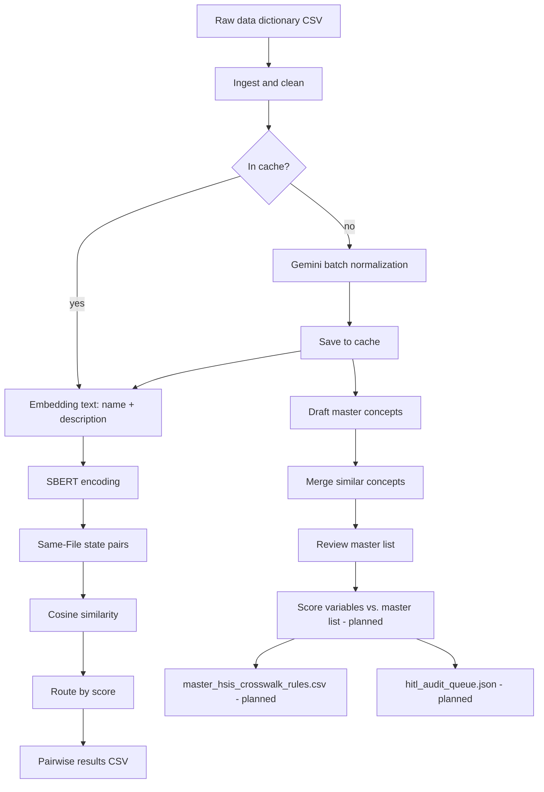

# HSIS Metadata Matcher

THIS DESCRIPTION WAS WRITTEN BY AI

Harmonizes variables across state DOT data dictionaries. Each variable is normalized by an LLM, embedded with SBERT, and compared by cosine similarity. The project has two parts:

1. **Pairwise matching (built).** Compares variables across states within the same `File` and routes each pair to accepted, human review, or rejected.
2. **Master concept list (in progress).** Groups equivalent variables into master concepts built from the normalized descriptions. The planned deliverables are `master_hsis_crosswalk_rules.csv` and `hitl_audit_queue.json`.

This is a from-scratch rebuild of the earlier version: [hsis-metadata-nlp (archived)](https://github.com/tasnimhossenctr/hsis-metadata-nlp). That version matched variables to a hand-built master schema. This version has no master schema to start from, so it builds the master list from the data.

## Pipeline



### Part 1: Pairwise matching

1. **Ingest.** Read the CSV, validate columns, trim whitespace, drop blank and duplicate rows, and apply `--exclude_states`.
2. **Normalize.** Gemini (or OpenAI) returns `standard_name`, `domain_category`, `description`, and `unit_type` for each variable. Uncached variables are sent in batches of 10, and every result is cached.
3. **Embed.** The text `"<standard name>: <description>"` is encoded with `all-MiniLM-L6-v2` into a 384-dimensional vector.
4. **Pair.** Pairs form only within the same `File`, across every pair of different states.
5. **Score and route.** Cosine similarity decides the bucket:

   | Cosine similarity | Decision |
   |---|---|
   | >= 0.82 | `accepted` |
   | 0.70 to < 0.82 | `hitl_review` |
   | < 0.70 | `rejected` |

6. **Export.** One CSV with a `decision` column.

### Part 2: Master concepts

1. **Draft list** (`src/build_master_concepts.py`). Reads the cache and groups variables that share an identical `standard_name` within a `File`. Writes `outputs/variable_normalizations.csv` and `data/master_schema/hsis_master_concepts_draft.csv`. It only works once every variable is cached (it reports how many are missing).
2. **Merge** (`src/merge_master_concepts.py`). Clusters near-duplicate concepts by embedding similarity, within the same `File`. Writes `data/master_schema/hsis_master_concepts.csv` and `outputs/variable_concepts.csv`.
3. **Review (manual).** Check the merged list before using it. Large clusters can mix different concepts.
4. **Score against the master list (planned).** Compare each state variable to the reviewed concepts. At or above 0.82 goes to `master_hsis_crosswalk_rules.csv`. From 0.70 to below 0.82 goes to `hitl_audit_queue.json`. Below 0.70 is marked state-unique.

## Design rules

- Pairs stay within the same `File`, and a state is never paired with itself.
- `Field_Type` is not a filter, and it is not in the embedding text. Including it with the file name made unrelated variables score too similarly.
- The thresholds (0.82 and 0.70) are the same in both parts.
- Normalization results are cached by provider, so Gemini and OpenAI results never mix.

## Data

Input: `data/raw_states/hsis_raw_schema.csv`, about 1,520 variables from eight states across the `Roadway`, `Crash`, `Person`, and `Unit` files.

Columns:

```
Index,State,File,Variable_Name,Description,Field_Type
```

Example:

```
WA,Roadway,SPEED_LIMIT,Posted Speed Limit,Numeric
OH,Roadway,POSTED_SPEED_NBR,Speed Limit of Road,Numeric
```

Save the file as UTF-8 ("CSV UTF-8" in Excel). Other encodings fail with `UnicodeDecodeError`.

## Project layout

```
.
├── README.md
├── requirements.txt
├── .env.example
├── data/
│   ├── raw_states/hsis_raw_schema.csv        # input
│   ├── master_schema/                        # draft and merged master concepts
│   └── cache/llm_normalizations.json         # LLM cache (gitignored)
├── src/
│   ├── hsis_crosswalk_engine.py              # pairwise entry point
│   ├── llm_normalizer.py                     # normalization, batching, cache, Gemini/OpenAI
│   ├── pair_scorer.py                        # embedding, pairing, scoring, routing
│   ├── build_master_concepts.py              # draft master list from the cache
│   └── merge_master_concepts.py              # cluster similar concepts
├── outputs/                                  # results (gitignored)
└── tests/
```

## Setup

```bash
python -m venv .venv
source .venv/bin/activate        # Windows: .venv\Scripts\Activate.ps1
pip install -r requirements.txt
```

Set credentials as environment variables (Codespaces secrets or a local `.env`). Never commit real keys. See `.env.example`.

| Variable | Needed for | Notes |
|---|---|---|
| `GEMINI_API_KEY` | `--llm_provider gemini` | Required for Gemini |
| `GEMINI_MODEL` | optional | Pins one model and disables the fallback chain |
| `OPENAI_API_KEY` | `--llm_provider openai` | Required for OpenAI |
| `OPENAI_MODEL` | optional | Defaults to `gpt-4o-mini` |
| `OPENAI_BASE_URL` | optional | Only if your organization uses a gateway |

## Usage

Normalize all variables and write the pairwise results:

```bash
python src/hsis_crosswalk_engine.py --llm_provider gemini --output outputs/gemini_matches_v3.csv
```

Retry automatically after temporary errors (progress is cached, so each retry resumes):

```bash
unset GEMINI_MODEL
for i in $(seq 1 30); do
  python src/hsis_crosswalk_engine.py --llm_provider gemini --output outputs/gemini_matches_v3.csv && break
  echo "Run failed (attempt $i of 30). Waiting 60 seconds..."
  sleep 60
done
```

Check how many variables still need normalizing:

```bash
python -c "
import sys; sys.path.insert(0,'src')
import pandas as pd
from llm_normalizer import build_cache_key, load_cache
df = pd.read_csv('data/raw_states/hsis_raw_schema.csv', dtype=str).fillna('').apply(lambda c: c.str.strip())
df = df[df.Variable_Name!=''].drop_duplicates(['State','File','Variable_Name'])
c = load_cache()
left = sum(build_cache_key(r.State,r.Variable_Name,r.Description,r.Field_Type,'gemini','auto') not in c for r in df.itertuples())
print(left, 'of', len(df), 'still need normalizing')
"
```

Build the master concept list (requires `0 missing from cache`):

```bash
python src/build_master_concepts.py
python src/merge_master_concepts.py
```

Engine options:

| Flag | Default | Purpose |
|---|---|---|
| `--input` | `data/raw_states/hsis_raw_schema.csv` | Input CSV |
| `--output` | `outputs/step3_candidate_matches.csv` | Results CSV |
| `--llm_provider` | `gemini` | `gemini`, `openai`, or `offline` |
| `--accept` | `0.82` | Accepted threshold |
| `--review` | `0.70` | HITL threshold |
| `--exclude_states` | none | State codes to skip |
| `--min_score` | `0.0` | Drop pairs below this score |

## Output

**Pairwise results CSV** (one row per pair, sorted by score):

`file, state_a, variable_a, description_a, state_b, variable_b, description_b, text_a, text_b, cosine_similarity, decision, reviewer_status, reviewer_notes`

<<<<<<< Updated upstream
The v3 run scored about 92,900 pairs: 
=======
The v3 run scored about 92,900 pairs: 
>>>>>>> Stashed changes
